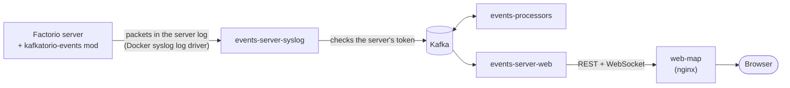

# Kafkatorio

Kafkatorio streams what happens on a [Factorio](https://www.factorio.com/) server to
[Apache Kafka](https://kafka.apache.org/), and turns it into a live website for the server:

* **Map** – a live map of every surface, with terrain, resource patches (with their size or
  number of wells), buildings (with their direction and recipe), belts, and players moving in real
  time.
* **Production** – what's produced and consumed per minute, and science packs used, over the
  last 10 minutes up to the last 7 days, for all surfaces or one.
* **Research** – what's researched, the current research and queue, and how many science packs are
  left. Shown as a filterable list, or as a tree like the game's technology screen.

It's built for Factorio 2.0, and works with large mod packs (it's used with Space Exploration and
Krastorio 2).

This is a fork of [adamko-dev/kafkatorio](https://github.com/adamko-dev/kafkatorio), updated for
Factorio 2.0, with the production and research pages and many fixes.

## Running it yourself

You need a Factorio server running in Docker, and a machine to build the images on.
**[The guide](./docs/guide.md)** covers building, configuring, connecting the Factorio server,
and putting the website behind a reverse proxy, with a ready-made setup for Unraid.

## How it works



1. The mod, [`events-mod`](./modules/events-mod) (written in TypeScript, compiled to Lua), listens
   to in-game events, groups and de-bounces them, and prints them as JSON packets to the server
   log.
2. Docker's syslog log driver forwards the Factorio container's log to
   [`events-server-syslog`](./modules/events-server-syslog). Each server's log is tagged with a
   token (a JWT), so only known servers are accepted. The packets go to a Kafka topic.
3. [`events-processors`](./modules/events-processors) uses Kafka Streams to turn the packets into
   map tiles, buildings, resource patches, and so on.
4. [`events-server-web`](./modules/events-server-web) serves the tiles and the other data over a
   REST API, and pushes live updates (such as players moving) over a WebSocket.
5. [`web-map`](./modules/web-map) is the website (Kotlin/JS, with Leaflet for the map). Its nginx
   also forwards `/kafkatorio/` to `events-server-web`, so the whole site is on a single port.

The packet format is defined once in [`events-library`](./modules/events-library) (Kotlin), which
also generates the mod's TypeScript types.

## Building

```shell
./gradlew build                 # build and test
./gradlew :modules:events-mod:distZip
                                # the mod: modules/events-mod/build/distributions/
```

See [the guide](./docs/guide.md#1-build-the-docker-images-and-the-mod) for building the Docker
images.

## License

Kafkatorio is licensed under the
[**GNU General Public License v3.0**](https://choosealicense.com/licenses/gpl-3.0/).
